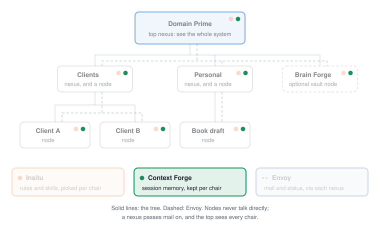

# Context Forge

Context Forge gives every AI project a local memory of its sessions, so the next session, in any AI client, picks up where the last one left off.

## The problem

AI clients don't share sessions. A new sitting loads your instructions, not last Tuesday. So every session starts by re-explaining where things stand, and whatever the last one figured out is gone unless you saved it somewhere by hand. Switch clients and it's worse: each one remembers only itself, if it remembers at all.

## What you get

- **A session card at the start.** One call returns what the project always wants loaded, the latest sittings, and any brief the last session left for this one.
- **Two kinds of memory.** Working files hold the current state and are replaced in place. Sittings are dated records of each session that pile up as history.
- **A note to your next self.** A session can leave a brief for the next one, or park it for later. When it says to wait, the next session presents the brief before doing anything else.
- **Every AI client, one memory.** The store lives on your machine, not in any client, so a sitting written in one client is waiting in the next.
- **Walls between projects.** Search never crosses projects. A query in one project can't return another project's notes.
- **Plain files you own.** Everything is markdown you can open, edit, or version. The search index rebuilds itself from those files.

## A day with it

A made-up project, `harbor-notes`.

Monday's session ends with the agent writing a sitting: what changed, what's half done, what to check next. It also updates the working file that says where the project stands.

Tuesday you open a different AI client. Its first call fetches the session card, so it starts with Monday's state and the two most recent sittings already in view. You ask what was decided about the export format three weeks ago. That's older than the card shows, so the agent searches this project's sittings and finds it.

Before you stop, you ask the agent to leave a brief for tomorrow and mark it to wait. Wednesday's session presents that brief first, before anything else.

Nothing was captured behind your back. Every record exists because a session chose to write it.

## Part of Domain Prime

<picture>
  <source media="(prefers-color-scheme: dark)" srcset="docs/domain-prime-dark.svg">
  
</picture>

Context Forge is one of four engines in [Domain Prime](https://github.com/srmackey/domainprime), a local-first system for running many AI projects as a tree. Every chair keeps its own memory, stored inside its own line of work, and never searched from outside it. It also runs on its own: without a tree, one store under your home folder holds every project's memory. Terms like chair, nexus, and sitting are defined in the [glossary](https://github.com/srmackey/domainprime/blob/main/docs/glossary.md).

## How it works

Context Forge gives an AI client a local memory of one workspace: working files and sitting notes, stored as markdown.

Not for a wiki, standing guidance, or a bulletin. There is no search across workspaces.

Markdown under `~/.contextforge/` is the source of truth (override with `CONTEXTFORGE_HOME`). SQLite + FTS5 is a derived index and can be rebuilt.

Set `CONTEXTFORGE_ROOT` to an install that has `nexus.md` when each nexus should keep its own store at `<nexus>/_contextforge/`. A call then names an address (`pier/dock`). The workspace slug stays the folder basename. Without that root, the single store above is the whole product.

## Capabilities

Five tools. Each call names one workspace.

| Tool | Inputs | Returns | Side effects |
|---|---|---|---|
| `get_pack` | workspace, optional query, limit, path | The session card: included files, recent sittings, and the session brief | Reads the vault. Reindexes files changed on disk. Binds the workspace when `path` is set. |
| `write` | workspace, path, content | The written document | Writes a sitting. The path must be under `sittings/`. |
| `write_working` | workspace, path, content | The written document | Writes a working file. The path must not be under `sittings/`. `syos.md` is the session brief. |
| `search` | workspace, query, optional limit | Hits and a count | Reads one workspace. Reindexes files changed on disk. Does not write a document. |
| `bind_workspace` | path, optional slug and always_include | Workspace meta | Writes the workspace record in the vault. Does not read that folder's files. |

Every tool sets `openWorldHint` false. `search` is read-only. The other four can write in the vault, and a second call with the same arguments does not add more damage. `get_pack` writes only when `path` is set and a bind runs.

On initialize the server returns a short operating note (call `get_pack` at session start, use `write` for sittings and `write_working` for everything else). That note lives in the server. This page does not repeat it.

How the pieces fit together is in [DESIGN.md](DESIGN.md).

## Requirements

- Python 3.11+
- [uv](https://docs.astral.sh/uv/)
- FastMCP 2, over stdio

## Configure a client

The procedure is [install/README.md](install/README.md). The block is [install/mcp.json.examples.md](install/mcp.json.examples.md). Host files come from `platforms.yaml` next to `nexus.md`. With no environment file, user-global host config is left alone, and no project instruction file is written.

```yaml
command: uv
args: ["run", "--directory", "/path/to/context-forge", "contextforge"]
```

Set `CONTEXTFORGE_HOME` when the vault should not be `~/.contextforge`.

## Trust boundary

- Transport is stdio. The host starts a local process as the user who launched it.
- Without `CONTEXTFORGE_ROOT`, the process reads and writes only under the vault (`CONTEXTFORGE_HOME`, or `~/.contextforge`). With that root set, it reads and writes `_contextforge/` under each nexus folder in the install.
- Binding a workspace stores that folder's path. The server does not read or write the folder's files.
- It does not use the network and it does not take a credential.
- It does write markdown and a derived SQLite index inside the vault.
- A path that escapes the workspace is refused.

The same boundary, and how to report a vulnerability, is in [SECURITY.md](SECURITY.md).

## Develop from source

```bash
uv sync
uv run pytest
uv run contextforge
```

Tests use fictional workspaces (`harbor-notes`, `river-ledger`). Do not point a run at a real vault.

There is no published package yet. Install by cloning and running from the checkout, as above.

## Versioning

A tool add, remove, or rename updates the capabilities table and [CHANGELOG.md](CHANGELOG.md) in the same change. The package version is in `pyproject.toml`.

## License

MIT. See [LICENSE](LICENSE).
